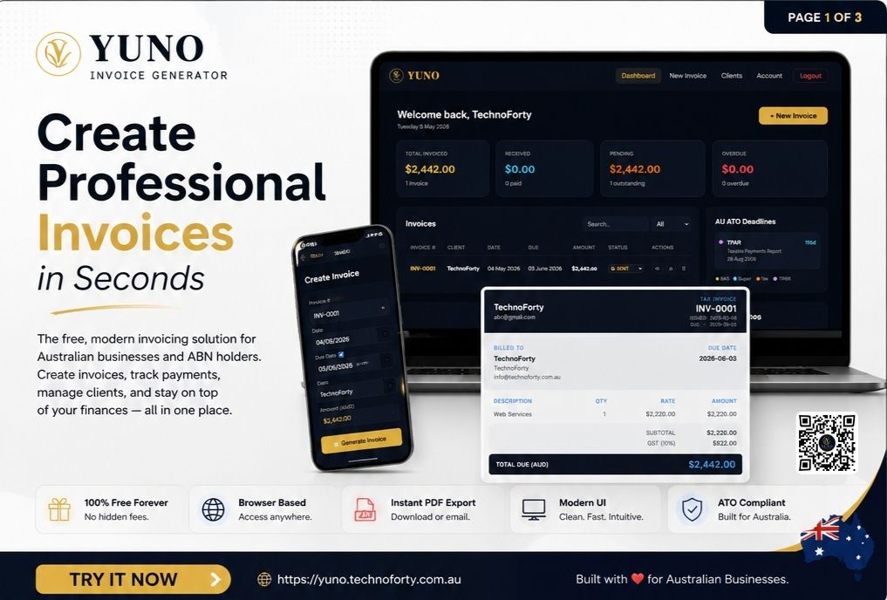
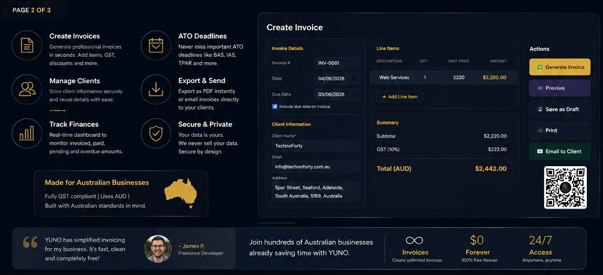

# YUNO Invoice Generator

<div align="center">

> **Create polished invoices in minutes, not hours.**  
> Built for Australian sole traders, freelancers, and small business owners.

[](https://github.com/itssudipkumar/Yuno-InvoiceGenrator/)
[](https://react.dev)
[](https://www.typescriptlang.org)
[](LICENSE)

</div>

---

## Why YUNO

YUNO keeps invoicing simple, clean, and private. It helps you create professional invoices quickly, preview them beautifully, and keep your business moving without clutter.

| Clean workflow | Professional output | Private by design |
|---|---|---|
| Fast invoice creation | Stylish templates | Cloud access with your account |

**Powered by [TechnoForty](https://technoforty.com)**

---

## Preview

<div align="center">

<div style="max-width: 900px; margin: 0 auto;">
  <div style="margin-bottom: 24px;">
    
    <div style="margin-top: 10px;"><strong>Dashboard</strong></div>
  </div>

  <div style="margin-bottom: 24px;">
    
    <div style="margin-top: 10px;"><strong>Invoice Builder</strong></div>
  </div>

  <div>
    
    <div style="margin-top: 10px;"><strong>Template Library</strong></div>
  </div>
</div>

</div>

---

## Try It

<div align="center">


### Scan to open the latest version

Works on desktop and mobile. No registration needed.

</div>

---

## Highlights

- 5 invoice designs with a polished, professional look
- GST-aware calculations and Australian business fields
- Guest and registered user flows
- Saved clients and invoice history
- One-click PDF downloads and print-ready output
- Monthly revenue and received-payment analytics
- Recurring invoice schedules that create drafts for review
- Email-verified accounts and cloud storage for access across devices
- Optional import of existing local account data, without deleting the original

PDF downloads use the selected invoice design, including its colours and layout.
Previously saved Prism, Linen, and Blueprint invoices are displayed using the
closest available design (Frost, Terra, and Slate respectively). The downloaded
PDF is image-based rather than selectable text.

---

## Getting Started

```bash
git clone https://github.com/itssudipkumar/Yuno-InvoiceGenrator.git
cd Yuno-InvoiceGenrator
pnpm install
pnpm dev
```

Open the app at [http://localhost:5173](http://localhost:5173).

### Supabase setup

Create a Supabase project and run `supabase/setup.sql` followed by
`supabase/recurring.sql` and `supabase/invoice-number-constraint.sql` in its SQL editor. These scripts create the tables,
per-user row-level security policies, and the function used to generate
recurring drafts atomically. Run `setup.sql` only once on an empty YUNO schema.
The invoice-number index fails rather than modifying data if an account already
has duplicate invoice numbers. Resolve duplicates before applying it.

Enable email/password authentication and **Confirm email** in Supabase Auth.
Set the Auth Site URL and allow the app URL (for local development,
`http://localhost:5173`) in the redirect URL allowlist. Add the deployed HTTPS
URL to the allowlist when deploying. The hosted Supabase default email sender
has delivery restrictions; configure a production SMTP provider before launch.

Create `.env.local` (ignored by Git) in the project root:

```env
VITE_SUPABASE_URL=https://YOUR_PROJECT.supabase.co
VITE_SUPABASE_ANON_KEY=YOUR_PUBLISHABLE_OR_ANON_KEY
```

Use only a publishable or legacy anon key in the browser, never a secret or
service-role key. Restart Vite after changing environment variables. Guest
invoices are not saved. Signed-in data is stored in Supabase; loading and saving
requires a network connection.

Existing local accounts are not cloud accounts. Create and verify a cloud account
using the same email, then use **Import local data** in Account on the device
holding the old data. Imports do not delete browser data, and existing imported
records are not overwritten on retry. Business details are replaced only if the
separate checkbox is selected. The old browser-based passwords remain in local
storage until the user clears that browser's data; do not clear it before
confirming any import.

### Build

```bash
pnpm build
```

---

## Support

If YUNO saves you time, consider supporting TechnoForty:

[](https://www.buymeacoffee.com/technoforty)

---

## License

MIT © [TechnoForty](https://technoforty.com)
